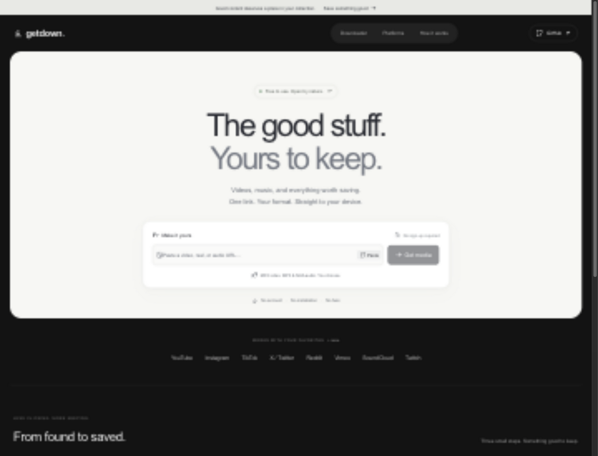
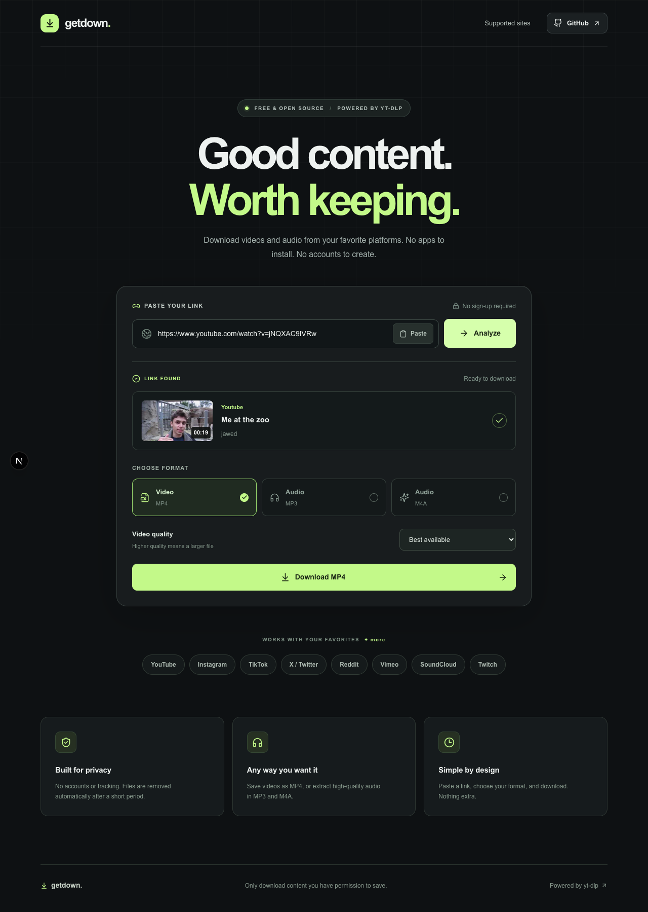
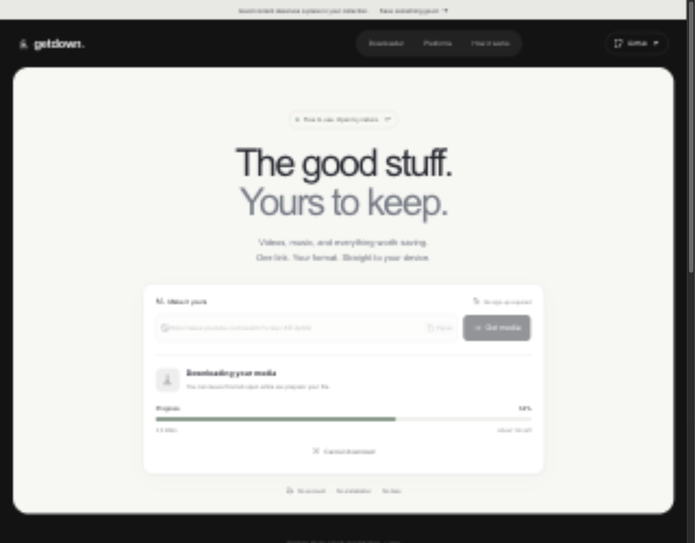
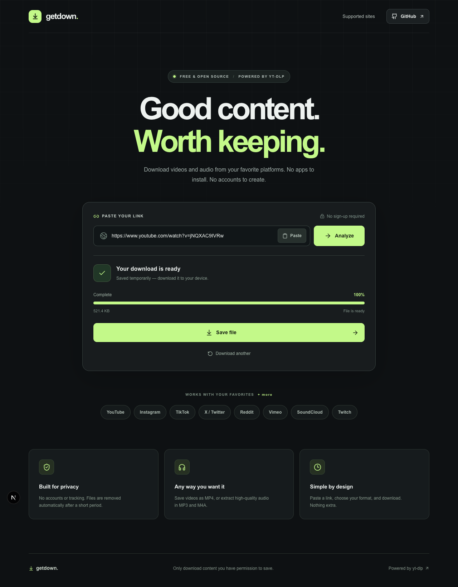
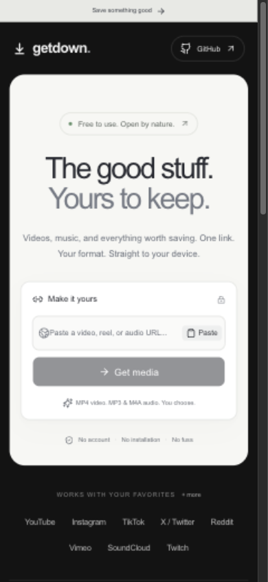

# getdown.

An open-source, self-hosted web downloader for videos and audio. Built with **Next.js 16, React 19, TypeScript, Tailwind CSS 4, yt-dlp, and FFmpeg**.

## Features

- Paste a link to inspect metadata, preview thumbnail, creator, duration, and available resolutions.
- Save **MP4**, **MP3**, or **M4A**, optionally limiting MP4 resolution.
- Real queue and progress from yt-dlp, cancellation, speed/ETA, browser download links, and session recovery after refresh.
- Limits for concurrency, queue depth, rate, file size, duration, and execution time.
- Automatic expiry of saved media; no user accounts or built-in analytics.
- Responsive, keyboard-accessible UI with Docker deployment.

## Screenshots

Actual browser captures of the redesigned interface. Download states use fixed demonstration data; these images do not represent a completed live download.

| Media preview and format selection | Download in progress |
| --- | --- |
|  |  |

Mobile homepage

## Quick start

**Docker + Compose** (installs yt-dlp and FFmpeg):

~~~sh
docker compose up -d --build
~~~

Open **http://localhost:3000**. Health check: **http://localhost:3000/api/health**.

**Local development** needs Node.js 22+, Python yt-dlp and FFmpeg on PATH:

~~~sh
python3 -m pip install -U yt-dlp
pnpm install --frozen-lockfile
pnpm dev
~~~

You can copy `.env.example` to `.env.local` and customize settings. The default non-Docker download directory is `/tmp/downloader-files`.

~~~sh
pnpm typecheck
pnpm lint
pnpm test
pnpm build
~~~

Production at **https://down.livvux.dev** uses the isolated Dokploy setup documented in [deploy/README.md](deploy/README.md).

## Configuration

| Environment variable | Default | Purpose |
| --- | --- | --- |
| `YT_DLP_BIN` | `yt-dlp` | Executable for yt-dlp |
| `YT_DLP_PROXY` | empty | Optional HTTP proxy passed explicitly to yt-dlp |
| `DOWNLOAD_DIR` | `/tmp/downloader-files` (Docker: `/data/downloads`) | Writable file storage |
| `MAX_CONCURRENT_DOWNLOADS` | `2` | Concurrent workers |
| `MAX_QUEUED_DOWNLOADS` | `12` | Queued jobs before rejecting requests |
| `MAX_FILE_MB` | `500` | Per-file maximum |
| `MAX_DURATION_SECONDS` | `7200` | Maximum known media duration |
| `JOB_TIMEOUT_SECONDS` | `1800` | Timeout for download/conversion |
| `FILE_TTL_MINUTES` | `60` | Completed file retention |
| `TRUST_PROXY_HEADERS` | `0` | Trust forwarded client IP only if gateway overwrites it |
| `ADDITIONAL_ALLOWED_HOSTS` | empty | Extra trusted public domains, comma-separated |

## API

| Method | Route | Description |
| --- | --- | --- |
| POST | `/api/info` | JSON `{"url":"https://..."}`; returns `{media}` |
| POST | `/api/jobs` | JSON `{"url":"https://...", "format":"mp4", "quality":"720", "title":"Example"}`; returns `{job}` |
| GET | `/api/jobs/:id` | Current status and progress |
| DELETE | `/api/jobs/:id` | Cancel queued/running job |
| GET | `/api/jobs/:id/file` | Download completed file |
| GET | `/api/health` | 200 if yt-dlp + FFmpeg are installed |

Jobs can be `queued`, `downloading`, `processing`, `completed`, `failed`, or `cancelled`. Links use random UUIDs and expire after the retention interval.

## Supported websites

Enabled by default: YouTube, TikTok, Instagram, X/Twitter, Reddit, Vimeo, Twitch, SoundCloud, Facebook, Pinterest, Dailymotion, Streamable, Bandcamp, Bilibili, Bluesky, Tumblr, Imgur, Rumble, Kick. yt-dlp may support additional platforms, but this app intentionally restricts submitted URLs to reduce abuse and SSRF risk. Add trusted public domains using `ADDITIONAL_ALLOWED_HOSTS` where appropriate. Private, geo-blocked, DRM-protected, authenticated, live, and playlist media may fail and are not supported by this MVP.

## Security and production

1. **Block internal IP ranges at the network/egress layer before public deployment.** Hostname allowlisting validates only the top-level URL; yt-dlp may follow redirects, extractor requests and manifests to other hosts. Enforce a firewall against localhost, RFC1918, link-local, cloud metadata and private IPv6 destinations. Container capability dropping does **not** provide egress isolation. Do not mount cloud keys, private volumes, Docker socket or secrets.
2. **Run only one persistent instance.** Jobs, rate limits, and queue are **in-memory**, and downloaded files use local disk. Do not use Vercel/serverless or replicas without moving the queue to Redis/BullMQ and files to shared storage.
3. **Monitor abuse and resources.** Default rate limits are 30 previews and 12 new jobs per minute globally. Set `TRUST_PROXY_HEADERS=1` only behind a proxy which strips/replaces client-provided forwarding headers, and add gateway-level rate limiting for public use.
4. **Keep yt-dlp updated**, since extractors change frequently. Avoid logging sensitive URLs. No credentials, user cookies, or application secrets are intentionally passed to the yt-dlp subprocess.
5. **Only save media you own or are allowed to download.** Observe copyright law and site terms; this app does not bypass DRM.

The browser loads thumbnails from external sources. The app itself contains no analytics/tracking.

## Known limitations

- Restarting the app loses active job state; the file sweeper removes expired orphan media after a health check or new job initializes it.
- No playlist, image-gallery, live-stream, login-required media or distributed worker support yet.
- Merging/transcoding may take time after progress reaches the processing stage.

## License

MIT for the application; yt-dlp and FFmpeg retain their respective licenses.
